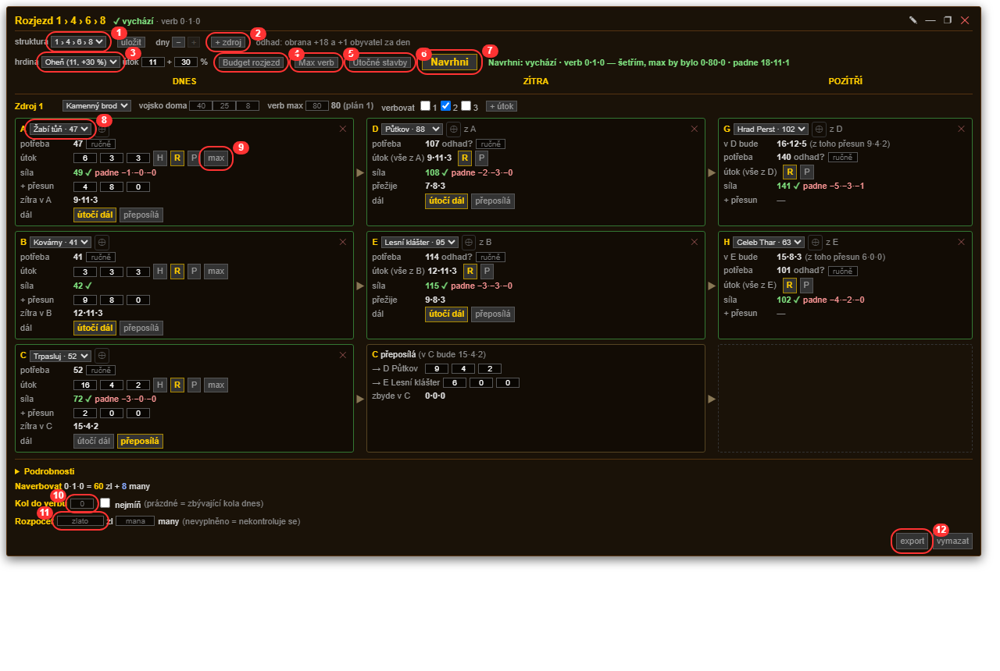
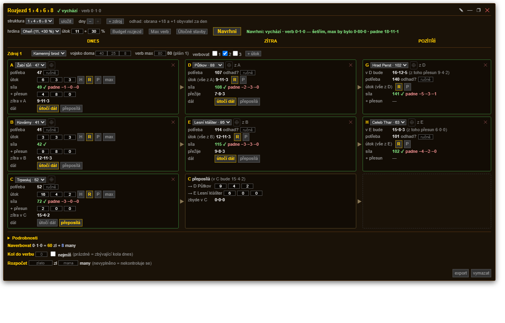
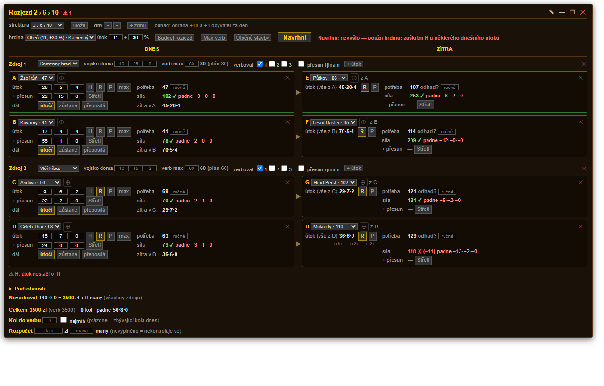
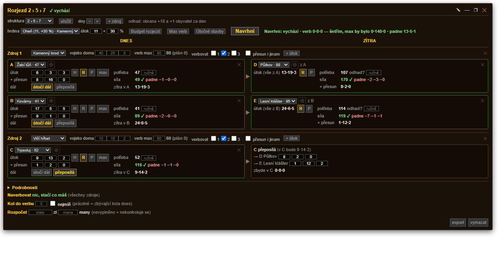
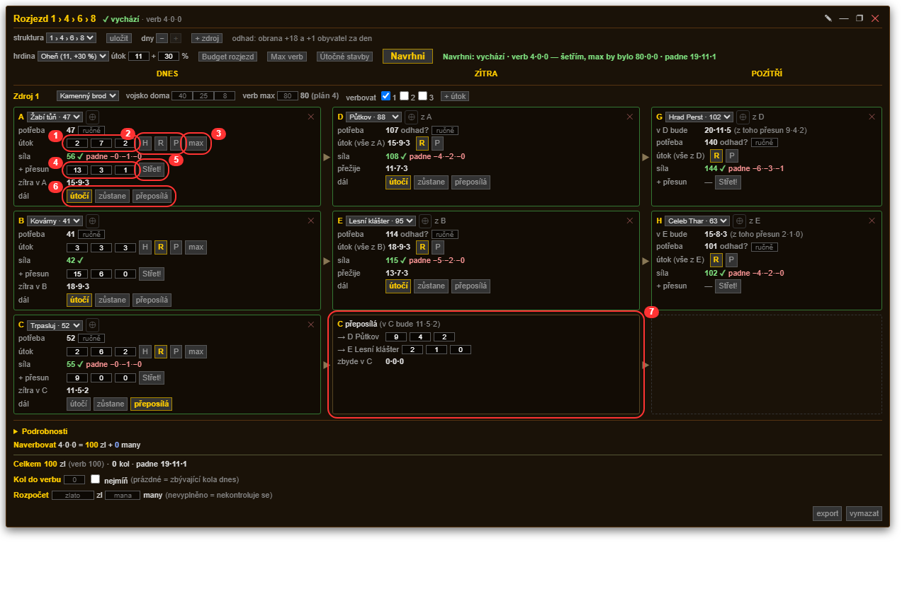

# Návod — Plánovač rozjezdů

> Tenhle návod psal Claude (AI) podle zdrojového kódu Plánovače, ne podle odehraných
> partií. Obrázky jsou vygenerované ze skutečného skriptu nad vymyšlenou mapou, takže
> **situace v nich jsou ilustrativní**: ukazují, jak se okno chová a co která věc dělá,
> ne jak se má hrát. Konkrétní plány z obrázků nemusí ve hře dávat smysl.

## 1. Otevření a okno

**Okno se otevírá přes neutrálku:** klikni v mapě na neutrální zem a vlevo na její
stránce, pod údaji o zemi, klikni na **Rozjezd ⇶**. Jinde tlačítko není. Okno se otevře
nad mapou (mapa musí být otevřená) a zůstane tam, i když vlevo klikáš na další země.

- **Posunout:** chyť lištu s názvem. Okno jde vystrčit i za okraj, vidět zůstane kousek lišty.
- **Šířka:** táhni za levý nebo pravý okraj. Od zhruba 1340 px se nastavení a souhrn
  přesunou do panelu vpravo a okno je nižší.
- **—** = sbalit do jednoho řádku (zpátky **▢**), **❐** = malé okno na výšku
  (jen země a jednotky; zpátky **□**), **✕** = zavřít.
- **✎** = vlastní zadání (kapitola 8).

Nahoře je název podle tvaru rozjezdu (počet zemí po každém dni) a stav: **✓ vychází**
nebo **⚠ počet chyb**.



1. **struktura** — předvolby tvaru rozjezdu a tvoje uložené (kapitola 2)
2. **+ zdroj** — další tvoje země, ze které se dnes útočí
3. **hrdina** — tvoji hrdinové ve zdrojích; útok a % jdou přepsat
4. **Budget rozjezd** — Navrhni použije co nejméně rytířů
5. **Max verb** — Navrhni naverbuje, co limit a rozpočet dovolí
6. **Útočné stavby** — ukáže u zdrojů stavby na zkoušku (kapitola 6)
7. **Navrhni** — rozpočítá celý plán
8. **roletka cíle** — sousední neutrálky, od nejslabší; vedle ní **⊕** vloží tu,
   na které vlevo stojíš
9. **max** — nasype do útoku všechno, co ve zdroji zbývá
10. **Kol do verbu** — kolik kol odehraješ, než budeš verbovat
11. **Rozpočet** — strop na verb a domy
12. **export** — celý plán do schránky jako text

Zapnuté přepínače svítí žlutě. **Navrhni** je větší, protože jako jediné doopravdy
počítá — ostatní tlačítka jen přepínají.

## 2. Struktura rozjezdu

- **struktura**: předvolby 1 › 4 › 6 › 8, 2 › 6 › 10, 2 › 5 › 7 a tvoje uložené (★).
  Země zdrojů zůstanou, cíle se vyprázdní.
- **dny − / +**: kolik sloupců (dnes / zítra / pozítří).
- **+ zdroj**: další tvoje země, ze které se dnes útočí. **+ útok** u zdroje: další útok dnes.
- **uložit**: uloží tvar (bez zemí a čísel) pod jeho názvem.

Každý řádek je jedna cesta: **dnes ▶ zítra ▶ pozítří**. Na kartě dnešního útoku je
**dál: útočí dál** (zítra útočí celé vojsko z dobyté země) nebo **přeposílá** (vojsko
z dobyté země se rozdělí do zítřejších útoků ostatních cest).

### 1 › 4 › 6 › 8 — z jedné země, třetí útok přeposílá



Klasika pro jednu silnou zem. Dnes z ní jdou tři útoky (A, B, C), zítra pokračují A a B
dál a **C jen přepošle** svoje vojsko do zítřejších cílů obou zbylých cest — přeposlaná
armáda dorazí až po dobytí, takže se boje neúčastní a jen doplní stavy. Pozítří se útočí
z D a E.

### 2 › 6 › 10 — dvě země, všechny cesty útočí dál



Dva zdroje po dvou útocích a zítra pokračují všechny čtyři cesty. Nejvíc zemí, ale chce
to dost vojska — nikdo nikomu nepomáhá.

### 2 › 5 › 7 — dvě země, třetí cesta přeposílá



Mezi tím: dvě země, slabší třetí útok se vzdá pokračování a zítra svoje vojsko rozdělí
do útoků, které jdou z první země.

## 3. Výběr cílů

- **roletka** u karty nabízí sousední neutrálky země, ze které se útočí, od nejslabší;
- **⊕** vloží neutrálku, na které vlevo zrovna stojíš.

**potřeba** je potřebný útok: dnes přesně z mapy, zítra a pozítří odhad (neutrálka
denně přiroste nejvýš o +18 obrany a 1 obyvatele, počítá se nejhorší případ). Když
skutečné číslo znáš, napiš ho do políčka **ručně**.

## 4. Karta útoku



1. **útok** — jednotky 1., 2. a 3. stupně
2. **H R P** — hrdina (pokračuje s tou cestou i další dny), rytíř (×1,1) a útok **bez
   vyhlášení války** (síla −30 %). Hodí se, když na dobyté zemi chceš hned volný
   průchod: s vyhlášenou válkou by smlouva naskočila až po přepočtu.
3. **max** — nasype do útoku všechno, co ve zdroji zbývá po ostatních útocích, **včetně
   toho, co ten krok posílá přesunem bokem**. Na zemi, kde hrozí střet s jiným
   útočníkem, je to to, co chceš: armáda z útoku se při prohře vrátí, kdežto přesun
   dorazí až po vyhodnocení boje a zůstal by vítězi.
4. **+ přesun** — přesun bokem do té země. Boje se neúčastní a zítra je tam celý.
5. **dál** — útočí dál, nebo přeposílá
6. **karta přeposílky** — kam se zítra rozdělí vojsko z dobyté země

- **síla**: ✓ stačí / ✗ chybí, **padne**: ztráty.
- **(+N)** pod útokem: kolik jednotek toho stupně chybí. Klik je přidá (zítra do
  přesunu bokem). Šedé = odtud už to poslat nejde.
- U Nekromantů je navíc vidět, kolik zombie vstane. Plán s nimi nepočítá, jsou to
  rezervy navíc.

## 5. Víc zdrojů

- **přesun i jinam** u zdroje: jeho vojsko smí jít přesunem bokem i do útoků ostatních
  zdrojů (v jejich kartách přibude řádek **+ z …**). Navrhni pak vyrovnává vojsko
  mezi zeměmi.
- **Zdroj, který jen posílá**: když u něj nevybereš cíl, karta ukáže, kolik pošle
  do kterého útoku, a co zůstane doma. Když odejde všechno, má zelený rámeček a 🔒.

**Kam až se dá poslat.** Vojsko projde k sousedovi, a přes zem, se kterou má **volný
průchod**, i k jejím sousedům. Dál ne — smlouva se dá uzavřít jen se sousedem a průchod
se neřetězí. Plánovač to hlídá:

- cíl, kam to jde, vypadá normálně;
- cíl, kam vede cesta přes zem **bez jakékoli smlouvy**, je živý a má u sebe šedivé
  **VP** — volný průchod si tam domluvíš a platí **hned** (změna smlouvy jinak naskočí
  až po přepočtu);
- cíl, kam se vojsko nedostane ani tak, je zamčený a označený **✖**.

U **zítřejší přeposílky** se smlouvy nečtou vůbec: dobytá zem s okolím ještě nic nemá,
takže si průchod uděláš s okamžitou platností. Proto se zabírají země vedle sebe — mají
sice válku s tou, ze které se na ně útočilo, ale mezi sebou nic.

## 6. Navrhni

- **verbovat 1 2 3**: ze kterých jednotek smí verbovat. Hlavní je zaškrtnutá dvojka nebo
  trojka s vyšším útokem, jedničky dorovnají.
- Navrhni naverbuje **jen tolik, kolik je potřeba**, aby všechno prošlo. Pak hledá
  rozdělení s co nejmenšími ztrátami (trojka je dražší než všechny dvojky, dvojka než
  všechny jedničky).
- **Budget rozjezd**: co nejméně rytířů.
- **Max verb**: naverbuje, co limit a rozpočet dovolí (třeba před střetem s nepřítelem).
- Přebytečné vojsko jde za hrdinou.
- Když útok nevyjde ani tak a s žádným útokem nejde hrdina, Navrhni napíše jen
  „použij hrdinu".

Cíle, hrdinu a „přeposílá" Navrhni nemění. Na stejné zadání dá vždy stejný plán.

### Útočné stavby na zkoušku

Tlačítko **Útočné stavby** ukáže u každého zdroje čtyři tlačítka: Polní modlitebna,
Kamenné cesty, Katapult, Aréna. Zapnutá stavba se **přepočítá do síly dnešních útoků**
z té země, takže hned vidíš, jestli ti chybějící útok dožene. Nikde se nekontroluje,
jestli tam opravdu stojí — rozhoduješ ty. Bonus patří zemi, ze které útok vyráží, takže
na další dny (útok z čerstvě dobyté země) nemá vliv.

## 7. Verb, domy, rozpočet

- **Naverbovat**: kolik a za kolik zlata a many.
- **Podrobnosti** (rozbalit): po zemích vojsko doma, verb, limit verbu po kolech,
  domy a kolik dokoupit.
- **verbovat 1 2 3** u zdroje: které stupně se v té zemi verbují. Dvojky chtějí v zemi
  Cech války, trojky Cech magie, takže tady zároveň říkáš, co ta zem umí. Ručně vepsaný
  verb stupně, který má zem odškrtnutý, se hlásí jako chyba.
- **Kol do verbu**: kolik kol odehraješ před verbem (obyvatelé přibudou). Prázdné =
  zbývající kola dnes. Zapni **nejmíň** a Navrhni dohledá nejmenší počet kol, se kterým
  plán ještě projde, a zapíše ho sem — kolo navíc bývá cennější než pár jednotek.
- **Rozpočet**: kolik zlata (verb i domy) a many můžeš dnes dát. Prázdné = nehlídá se.
- **Stavby** v souhrnu: co by stály zapnuté útočné stavby a cechy, které si verb vynutí
  (Cech války u dvojek, Cech magie u trojek). Je to **jen informace**, do rozpočtu se to
  nepočítá.

## 8. Vlastní zadání ✎

Pro výpočet za někoho jiného: rasa, hrdina, zdroje (vojsko doma a limit verbu číslem)
a místo neutrálky jde zadat jen **PÚ dnes** a bonus obrany. Plán vlastního zadání se
ukládá zvlášť. Druhým klikem na ✎ se vrátíš ke svému.

## 9. Export

**export** zkopíruje celý plán do schránky jako text v rámečcích (pro Discord v bloku
```). U každého útoku síla, potřeba, ztráty, H a R.

## 10. Vyplnění útoku na stránce Vojsko

Otevři **Vojsko** země, ze které útočíš. Nad řádkem „vojsko dorazí do cíle o půlnoci"
jsou kroky plánu z téhle země (dnešní útoky, přesuny bokem, zítřejší útok vším
z dobyté země). **Klik** vyplní jednotky, rytíře, hrdinu, cíl i typ akce.
**Odeslat vojsko** klikáš sám.

- šedý krok = cíl není mezi zeměmi, kam z téhle země jde poslat vojsko,
- ✓ … odesláno = ten útok už letí.

## 11. Odeslané útoky a další den

- V záhlaví karty: **✓ 66** síla letícího útoku (červeně, když nestačí), **✓ přesun**,
  **○ útok** = dnešní útok ještě neodešel.
- **🔒** odeslaný krok: čísla jsou pevná, Navrhni na ně nesáhne a vojsko se nepočítá
  doma. Klik na 🔒 odemkne (na dnešní den).
- **Nový herní den:** po přepočtu se plán sám posune. Dobyté země se stanou zdroji
  (s vojskem z mapy), zítřejší útoky jsou dnešní a jde je doladit přes Navrhni. Země,
  která přeposílala, posílá do dnešních útoků. Cesta útoku, který neprošel, se vynechá.
  V průběhu dne se plán neposouvá.
- Plán připravený večer dopředu se po přepočtu neposune ani nezamkne, dokud z něj nic
  neodejde.
